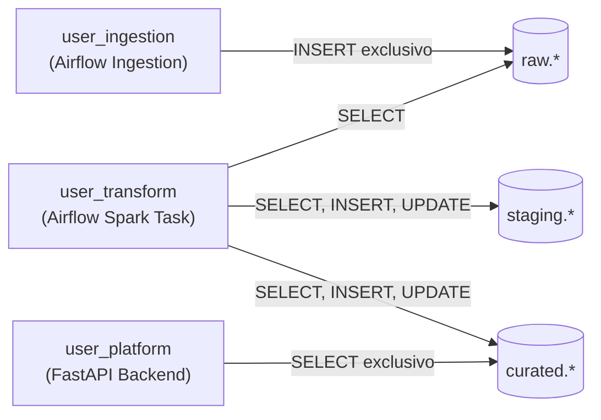

# Guía de Seguridad y Mínimo Privilegio: SismoWatch

## 1. Principio de Mínimo Privilegio en Base de Datos

Para evitar que una vulnerabilidad en una capa comprometa la totalidad del sistema, se configuraron tres roles independientes en PostgreSQL con permisos estrictamente acotados:



| Rol de Base de Datos | Usuario | Permisos Otorgados | Permisos Denegados |
| :--- | :--- | :--- | :--- |
| **Ingesta** | `user_ingestion` | `INSERT` en `raw.earthquake_events_raw`. | `SELECT`, `UPDATE`, `DELETE`, y ningún acceso a `staging` o `curated`. |
| **Transformación** | `user_transform` | `SELECT` en `raw`, `SELECT/INSERT/UPDATE` en `staging` y `curated`. | `DROP`, `ALTER`, `TRUNCATE` u operaciones DDL destructivas. |
| **Plataforma / Consumo** | `user_platform` | `SELECT` exclusivo sobre tablas analíticas de `curated`. | Ningún permiso de escritura (`INSERT`, `UPDATE`, `DELETE`) y ningún acceso a `raw` ni `staging`. |

---

## 2. Autenticación y Control de Acceso Basado en Roles (RBAC)

### 2.1 Modelo de Roles y Matriz de Acceso
La API de FastAPI implementa tokens firmados criptográficamente mediante **JWT (JSON Web Tokens)** con algoritmo `HS256`.

| Funcionalidad / Endpoint | Sin Sesión | Rol Viewer | Rol Admin |
| :--- | :---: | :---: | :---: |
| **Login (`POST /auth/login`)** | Permitido | Permitido | Permitido |
| **Dashboard y KPIs (`GET /api/kpis`)** | 401 Unauthorized | Permitido | Permitido |
| **Mapa y Eventos (`GET /api/events`)** | 401 Unauthorized | Permitido | Permitido |
| **Series Temporales (`GET /api/stats/timeseries`)** | 401 Unauthorized | Permitido | Permitido |
| **Transmisión en Vivo (`GET /api/stream`)** | 401 Unauthorized | Permitido | Permitido |
| **Historial y Exportación (`GET /api/reports`)** | 401 Unauthorized | Permitido | Permitido |
| **Chatbot Qwen 2.5:2b (`POST /api/chat`)** | 401 Unauthorized | Permitido | Permitido |
| **Estado del Pipeline (`GET /api/pipeline/status`)** | 401 Unauthorized | Solo resumen | Detalle completo |
| **Ver Registros Inválidos (`GET /api/quality/quarantine`)** | 401 Unauthorized | **403 Forbidden** | Permitido |
| **Lanzar Backfill Histórico (`POST /api/admin/backfill`)** | 401 Unauthorized | **403 Forbidden** | Permitido |
| **Regenerar Reporte IA (`POST /api/admin/reports/regenerate`)** | 401 Unauthorized | **403 Forbidden** | Permitido |

### 2.2 Siembra Segura de Credenciales
- Las credenciales iniciales de los usuarios `admin` y `viewer` se leen exclusivamente desde variables de entorno (`ADMIN_PASSWORD`, `VIEWER_PASSWORD`).
- En la base de datos, las contraseñas se almacenan con hashing seguro mediante **bcrypt**. Nunca se almacenan contraseñas en texto plano.

---

## 3. Mitigación de Amenazas en Inteligencia Artificial (OWASP Top 10 LLM)

### 3.1 Mitigación de Prompt Injection (LLM01)
El campo `place` que proviene del GeoJSON de USGS es un texto libre que podría ser manipulado maliciosamente para inyectar instrucciones al modelo de lenguaje.
- **Sanitización Estricta:** Antes de concatenar cualquier variable en los prompts, el texto es procesado por una función que:
  1. Elimina caracteres de control y delimitadores de prompt (como `system:`, `user:`, backticks triples, etiquetas markdown maliciosas).
  2. Trunca la longitud máxima del texto a 100 caracteres.
  3. Aplica un *allowlist* de caracteres permitidos (letras, números, comas, guiones, puntos y espacios).

### 3.2 Seguridad en Text-to-SQL (Chatbot con Qwen 2.5:2b)
Para evitar inyecciones SQL a través del agente conversacional:
1. **Validación Sintáctica Obligatoria:** Toda consulta SQL generada por el LLM pasa por un validador regex/AST que asegura que comience estrictamente con la palabra `SELECT`.
2. **Lista Negra de Palabras Clave:** Si la consulta contiene palabras como `INSERT`, `UPDATE`, `DELETE`, `DROP`, `ALTER`, `TRUNCATE`, `EXEC`, o `;`, es rechazada inmediatamente.
3. **Aislamiento de Schema:** Solo se permite consultar tablas dentro del schema `curated`.
4. **Ejecución con Mínimo Privilegio:** La conexión de base de datos usada para el chatbot pertenece a `user_platform`, que a nivel del motor PostgreSQL tiene prohibido cualquier tipo de mutación.

---

## 4. Gestión de Secretos y Cero Fugas en Repositorio

1. **`.env` Ignorado:** El archivo `.env` está expresamente excluido en el `.gitignore`. Únicamente se incluye `.env.example` con valores de plantilla inofensivos.
2. **Claves Criptográficas:** La clave Fernet de Apache Airflow (`AIRFLOW__CORE__FERNET_KEY`) y el secreto JWT (`JWT_SECRET_KEY`) se autogeneran y no se reutilizan entre ambientes.
3. **Logs Limpios:** Todos los loggers de Airflow y FastAPI filtran cabeceras `Authorization`, contraseñas y payloads sensibles.

---

## 5. Auditoría y Escaneo Automatizado de Vulnerabilidades

Para verificar el cumplimiento de seguridad en el código y las dependencias, ejecutamos las siguientes herramientas en el pipeline:

### 5.1 Escaneo de Vulnerabilidades en Dependencias con `pip-audit`
```bash
pip-audit
```
Audita el árbol de dependencias frente a la base de datos oficial de vulnerabilidades (PyPI Advisory Database).

### 5.2 Análisis Estático de Seguridad con `bandit`
```bash
bandit -r airflow/include api -ll
```
Analiza posibles vulnerabilidades en el código fuente de Python (inyecciones SQL, uso de `eval`, manejo inseguro de subprocesos o secretos hardcodeados).
